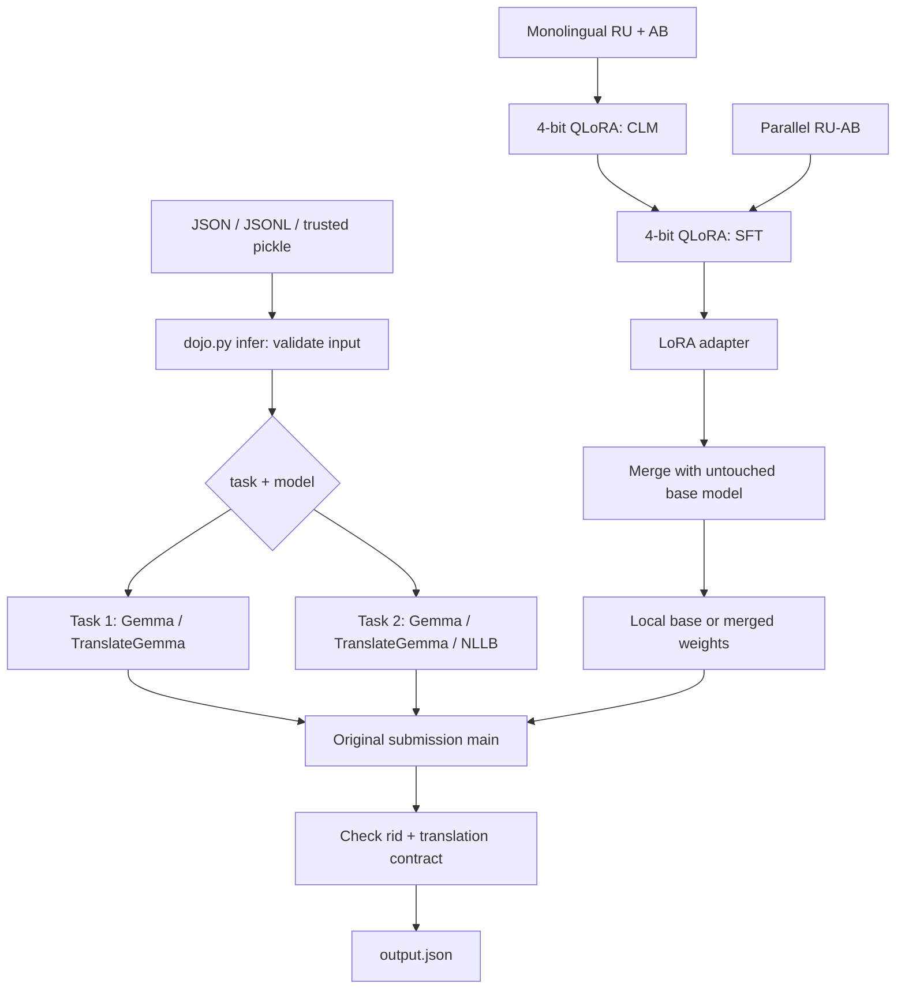

# Архитектура

Проект сохраняет две самостоятельные задачи и несколько модельных линий. Общий слой задаёт единый интерфейс работы с файлами; алгоритмы перевода остаются в конкурсных `submission*/solution.py`. Это позволяет изучать конкретную посылку без зависимости от исследовательского CLI.

## Слои

| Слой | Файлы | Ответственность |
|---|---|---|
| Интерфейс | `dojo.py` | Выбор задачи/модели, проверка формата, пути, загрузка и упаковка |
| Конкурсный inference | `task-*/submission*/solution.py` | Model loading, prompt/chat template, batching, generation, decode |
| Локальные исследования | `task-*/scripts/local_inference.py`, `compare_models.py`, `bench_*.py` | Сравнение моделей и производительности; собственные исторические настройки |
| Данные | `prepare_*.py`, `convert_datasets.py`, `task-2/train/data.py` | Форматы, фильтрация, seed, разбиение и смешивание корпусов |
| Обучение | `task-*/train/`, `scripts/train_*.py` | Квантование, PEFT, токенизация и маскирование loss, Trainer, checkpoint callbacks |
| Эксперимент | `configs/*.yaml`, `configs/*/*.yaml` | Пути, LoRA rank, длина, learning rate и расписание |
| Оценка | `task-1/eval/`, `scripts/eval_bleu.py` | Выравнивание по `rid`, sentence BLEU, среднее и диагностика |

`dojo.py infer` загружает исходный модуль, задаёт только абсолютный `MODEL_DIR` и вызывает `main()` во временной рабочей папке. Существующие числовые параметры, промпты, генерация и postprocess не переопределяются. Временный input приводится к конкурсному pickle, output проверяется и сохраняется по пользовательскому пути. В Task 1 / Gemma после `--` можно передавать поддерживаемые исходной программой параметры устройства, квантования и размера батча.

`train` и `evaluate` запускают существующие скрипты отдельным процессом в каталоге нужной задачи. Это изолирует одноимённые локальные Python-модули `train` и `eval`, а также сохраняет смысл относительных путей в YAML. Сам путь к YAML передаётся относительно текущего каталога пользователя.

## Модельные линии

**Gemma** использует обычное текстовое сообщение пользователя и шаблон чата. В текущем Task 1 / Gemma применены исходный RU-промпт и beam search; исследовательские English/few-shot промпты находятся рядом, но не включаются автоматически в `dojo.py infer`.

**TranslateGemma** получает structured message с `source_lang_code`, `target_lang_code` и текстом. В Task 2 генерация батчами использует left padding; конкурсный код отрезает весь padded input перед decode. Это существенная деталь: длина непадденного текста отдельного примера даёт другой срез. Исторические локальные раннеры сохранены для исследования и могут отличаться от исправленного конкурсного кода.

**NLLB** использует seq2seq-модель, `rus_Cyrl` → `abk_Cyrl`, forced BOS и beam search. Ветка имеет собственный trainer и языковые функции в `task-2/train/nllb_*.py`. CLI не предоставляет NLLB для Task 1, потому что такой реализации в решении нет.

## Обучение и веса

CLM адаптирует модель к моноязычному тексту. SFT учит переводу параллельных пар; для causal LM loss маскируется на переводе согласно конфигу. Используется QLoRA: NF4-квантование базовой модели и обучаемые LoRA-адаптеры. Модули `kbit.py`, `gemma_peft.py` и собственные Trainer-классы содержат уже существовавшие адаптации для ограниченной VRAM и Gemma.

Адаптеры и полные модели — разные артефакты. `merge_lora.py` объединяет адаптер с исходными весами в bf16 для автономного инференса. Нельзя повторно использовать уже merged модель как исходную базу того же адаптера. Для экспериментов сохраняйте исходную базу отдельно и явно задавайте `--base` / `--out`.

Вспомогательные файлы Task 1, отсутствовавшие в рабочем дереве, восстановлены из существовавшего коммита `62e1c30`, чтобы команды обучения и merge снова ссылались на реальные модули. Их алгоритмы не переписаны.

## Контракты

Вход: список `{"rid": int, "src": str}`. Внешний CLI принимает JSON, JSONL или доверенный pickle; `rid` уникален. Выход: список `{"rid": int, "translation": str}` с тем же набором идентификаторов. Метрика сопоставляет перевод и эталон по `rid`. Pickle допускает выполнение кода при чтении; для сторонних входных данных используйте JSON/JSONL.

Docker/ZIP не зависит от корневого CLI: достаточно `Dockerfile`, исходных `.py` и `weights/`. Инференс внутри контейнера не скачивает модель.
