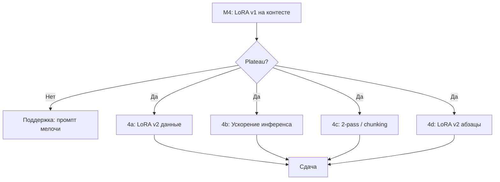

# План решения task-1 и дорожная карта модернизаций

Пошаговый план работ: от первой сдачи до итераций с LoRA и тяжёлыми приёмами.  
Каталог подходов и **объёмы данных** по уровням: [SOLUTION_STRATEGIES.md](SOLUTION_STRATEGIES.md).  
Метрика и чеклисты: [BLEU.md](BLEU.md). Условие: [SPECS.md](SPECS.md).

Журнал экспериментов: `experiments/JOURNAL.md` (append-only).

---

## 1. Цели и критерии успеха

| Этап | Цель | Критерий готовности |
|------|------|---------------------|
| **M0** | Рабочий пайплайн | Docker smoke, `output.json`, образ < 20 GB |
| **M1** | Калибровка на контесте | Первая оценка BLEU (бейзлайн) |
| **M2** | Быстрые улучшения без обучения | +macro BLEU на paragraph-dev vs M1 |
| **M3** | Стабильный dev-цикл | `eval_dev.py`, paragraph-dev ≥ 300 абзацев |
| **M4** | LoRA v1 | Обучение + merge/adapter, прирост на dev и контест |
| **M5** | Продвинутые приёмы | Только при plateau M4 |

**Главная метрика сдачи:** macro-average BLEU (69 скрытых абзацев).  
**Операционные метрики:** время на 69 запросов ≤ 45 мин; размер образа < 20 GB.

---

## 2. Подготовка данных (один раз, параллельно с фазами)

Данные не входят в обязательный zip, кроме глоссария / артефактов в `weights/`.

### 2.1. Наборы

```
data/
├── raw/                    # OPUS/WMT скачивание (не в git, .gitignore)
├── flores_sentence/        # FLORES dev — sentence dev, быстрый старт
├── paragraph_dev/          # 300–500 абзацев EN+RU (основной dev)
├── paragraph_valid/        # hold-out для LoRA early stopping
├── lora_train/             # 100k–300k предл. или 10k–30k абзацев
└── glossary.json           # 50–500 терминов (опционально в zip)
```

### 2.2. Как собрать paragraph-dev (целевой объём)

| Шаг | Действие | Объём |
|-----|----------|-------|
| 1 | FLORES `dev`: быстрый sentence-dev | 997 предложений |
| 2 | OPUS News/Wiki: группировка по документу/URL, склейка 5–12 предложений | **300–500** абзацев |
| 3 | Hold-out 10–15% в `paragraph_valid` | 50–80 абзацев |
| 4 | Ручная выборка 20 абзацев | Разбор ошибок (термины, обрезка) |

**Срок:** 0.5–1 день после настройки скрипта `scripts/build_paragraph_dev.py` (создать при входе в фазу 2).

### 2.3. Наборы для LoRA (фаза 4)

| Набор | Минимум | Рекомендация | Источник |
|-------|---------|--------------|----------|
| Train | 20k предложений | 100k–300k, длина 5–80 токенов EN | OPUS News + Wiki, фильтр |
| Train (абзацы) | 2k абзацев | 10k–30k | Склейка документов |
| Valid | 1k предложений / 200 абзацев | 2k–5k / 300–800 | Отдельный shard OPUS, не paragraph_dev |

---

## 3. Фазы реализации

### Фаза 0 — Инфраструктура (1–2 дня)

**Уровни:** 0  
**Данные:** 0 train; `examples/example-input.pickle`

| # | Задача | Артефакт |
|---|--------|----------|
| 0.1 | `conda run -n ml-env python download_weights.py` | `submission/weights/` |
| 0.2 | `docker build ./submission` + run на example | `out/output.json` |
| 0.3 | Замер времени на 69 (если есть вход) или экстраполяция | Запись в JOURNAL |
| 0.4 | **Сдача 1** — бейзлайн без изменений | Балл контеста M1 |

**Выход:** M0 + M1.

---

### Фаза 1 — Inference без обучения (2–4 дня)

**Уровни:** 1, 2, 3  
**Данные:** paragraph-dev **100** (старт) → **300**; few-shot 1–3 вручную; 20–50 примеров для postprocess

| # | Задача | Файлы | Данные |
|---|--------|-------|--------|
| 1.1 | Вынести промпт в `prompts.py`, A/B 2–3 формулировок | `prompts.py` | 100+ абзацев dev |
| 1.2 | `postprocess.py`: срез преамбул, кавычек | `postprocess.py` | 20–50 примеров |
| 1.3 | Динамический `max_new_tokens` от длины `src` | `solution.py` / `inference.py` | длинные абзацы dev |
| 1.4 | `eval_dev.py` — macro `sentence_bleu` | `eval_dev.py` | paragraph-dev |
| 1.5 | **Сдача 2** — лучший промпт + postprocess | JOURNAL: dev BLEU, контест |

**Выход:** M2.

---

### Фаза 2 — Dev-корпус и качество пайплайна (2–3 дня)

**Уровни:** 5 (лёгкие части), подготовка к 6  
**Данные:** paragraph-dev **300–500**; глоссарий **50–200** терминов

| # | Задача | Файлы | Данные |
|---|--------|-------|--------|
| 2.1 | Скрипт сборки paragraph-dev | `scripts/build_paragraph_dev.py` | OPUS/WMT |
| 2.2 | `data/glossary.json` + подстановка в промпт | `glossary.py`, `data/` | 50–500 терминов |
| 2.3 | Промпт: согласованность терминов / местоимений | `prompts.py` | dev |
| 2.4 | Ручной аудит 20 худших по sentence BLEU | — | 20 абзацев |
| 2.5 | (Опционально) **Сдача 3** — глоссарий + промпт | если прирост на dev |

**Выход:** M3.

---

### Фаза 3 — LoRA v1 (5–10 дней)

**Уровень:** 6  
**Данные:** train **100k** предложений (или **5k** абзацев); valid **2k** / **300** абзацев

| # | Задача | Файлы | Данные |
|---|--------|-------|--------|
| 3.1 | `train_lora.py` — QLoRA, тот же chat template | `train_lora.py`, `configs/lora.yaml` | 20k пилот → 100k |
| 3.2 | Пилот на 10k, 1 эпоха — проверка loss / dev | — | 10k train |
| 3.3 | Полный прогон 100k–200k, early stopping | checkpoint | 100k–200k |
| 3.4 | `merge_lora.py` или adapter в `weights/lora/` | `merge_lora.py` | — |
| 3.5 | Инференс в Docker + `peft` при adapter | `inference.py`, `Dockerfile` | — |
| 3.6 | **Сдача 4** — LoRA v1 | dev + контест |

**Выход:** M4.

**Критерий остановки пилота:** macro BLEU на paragraph-valid не растёт 2 эпохи подряд → не масштабировать до 500k без смены данных/гиперов.

---

### Фаза 4 — Модернизации после LoRA v1 (по необходимости)

Выполнять **только если** сдача 4 не дала прироста или dev plateau.



#### 4a — LoRA v2: данные и домен

| Параметр | Значение |
|----------|----------|
| Train | **10k–30k** абзацев news/wiki **или** +200k отфильтрованных предложений |
| Valid | тот же paragraph_valid |
| Действие | Другой mix OPUS, фильтр длины 100–400 слов EN |
| Сдача | Когда dev +2…+5 BLEU (ориентир, не гарантия) |

#### 4b — Ускорение (уровень 4)

| Параметр | Значение |
|----------|----------|
| Данные | 0; бенчмарк 69 абзацев |
| Действие | `torch.compile` / vLLM — освободить время для 2-pass |
| Сдача | Если нужен запас под 4c |

#### 4c — Двухпроход без обучения (уровень 9 lite)

| Параметр | Значение |
|----------|----------|
| Данные | dev **100–200** абзацев — 2-pass не должен падать по BLEU |
| Действие | Pass1 translate; Pass2 «исправь термины, не меняй остальное» |
| Риск | 2× время → только при запасе после 4b |

#### 4d — Document-level train (уровень 6 расширенный)

| Параметр | Значение |
|----------|----------|
| Train | **5k–20k** document blocks 200–800 токенов |
| Действие | Переобучить LoRA с нуля на абзацах |
| Сдача | При стабильном выигрыше на paragraph-dev |

#### 4e — Не приоритет на старте

| Подход | Данные | Когда |
|--------|--------|-------|
| P-tuning (7) | 10k–50k | Мало VRAM, LoRA не влезает |
| Full FT (8) | 500k+ | Есть multi-GPU и недели |
| MBR best-of-3 (10) | dev 500+ ref | Есть ускорение 4b |

---

## 4. Карта сдач на контест (4 попытки / 24 ч)

Рекомендуемое **распределение** (подстроить под фактические баллы):

| Сдача | Фаза | Содержимое | Ожидаемые данные уже готовы |
|-------|------|------------|------------------------------|
| **1** | 0 | Чистый бейзлайн | weights HF |
| **2** | 1 | Промпт + postprocess + tokens | paragraph-dev 100+ |
| **3** | 2–3 пилот **или** 2 | Глоссарий **или** ранняя LoRA (если успели) | dev 300+, train 20k+ |
| **4** | 3 | LoRA v1 merge/adapter | train 100k+, valid 2k+ |

Если LoRA не готов к сдаче 3 — лучше **усилить фазу 1** (промпт), чем отправить недообученный адаптер.

---

## 5. Структура кода по фазам

| После фазы | Модули в репо |
|------------|----------------|
| 0 | `submission/` (`solution.py`, `Dockerfile`), `download_weights.py` |
| 1 | + `prompts.py`, `postprocess.py`, `eval_dev.py` (импорт в `submission/solution.py`) |
| 2 | + `scripts/build_paragraph_dev.py`, `data/glossary.json` |
| 3 | + `train_lora.py`, `merge_lora.py`, `inference.py`, `configs/` |
| 4 | опционально `train_lora_v2.py`, второй конфиг |

`solution.py` остаётся тонким entrypoint:

```python
# псевдокод целевого состояния после фазы 3
from inference import load_model, translate_paragraph

def main():
    model, processor = load_model("./weights", lora_path="./weights/lora")  # optional
    rows = load_pickle("input.pickle")
    results = [translate_paragraph(model, processor, r) for r in rows]
    save_json("output.json", results)
```

---

## 6. Риски и триггеры отката

| Симптом | Вероятная причина | Действие |
|---------|-------------------|----------|
| Dev BLEU ↑, контест ↓ | Переобучение dev / другой домен | Меньше train, другой mix, не трогать FLORES test |
| Обрезанные переводы | `max_new_tokens` | Фаза 1.3 |
| Преамбулы в выводе | Промпт / parse_response | Фаза 1.1–1.2 |
| Timeout > 45 мин | Медленный generate / 2-pass | 4b или урезать N |
| LoRA хуже бейзлайна | Мало данных / другой template | ≥20k train, сверить template |
| Образ > 20 GB | Два чекпоинта | merge LoRA, один `model.safetensors` |

---

## 7. Чеклист готовности к каждой модернизации

### Перед сдачей (любая фаза)

- [ ] Macro BLEU на paragraph-dev (не corpus_bleu)
- [ ] Docker: 69 примеров ≤ 45 мин
- [ ] `output.json`: только `rid`, `translation`
- [ ] Запись в `experiments/JOURNAL.md`

### Перед LoRA (фаза 3)

- [ ] Train ≥ **20k** пар (лучше **100k**)
- [ ] Valid отделён от train
- [ ] Формат SFT = формат `solution.py`
- [ ] Пилот 10k показал рост valid BLEU

### Перед 2-pass / MBR (фаза 4c–4e)

- [ ] Запас времени ≥ **2×** текущего прогона
- [ ] Dev 100+ абзацев: 2-pass не хуже 1-pass в среднем

---

## 8. Оценка трудозатрат (календарно)

| Фаза | Календарь (при part-time) | GPU |
|------|---------------------------|-----|
| 0 | 1–2 дня | smoke |
| 1 | 2–4 дня | инференс |
| 2 | 2–3 дня | CPU + инференс |
| 3 | 5–10 дней | QLoRA 1–3 суток train |
| 4 | итерации по 3–7 дней | по подзадаче |

**Итого до конкурентного решения:** ~2–4 недели с итерациями; **минимальный путь** (0+1+сдачи): ~1 неделя без LoRA.

---

## 9. Связанные документы

- [SOLUTION_STRATEGIES.md](SOLUTION_STRATEGIES.md) — уровни 0–10, объёмы данных, инструменты
- [BLEU.md](BLEU.md) — метрика, macro-average, чеклист
- [SPECS.md](SPECS.md) — лимиты контеста
- `experiments/JOURNAL.md` — фактические результаты сдач

---

*Обновляйте этот план после каждой сдачи: фиксируйте балл контеста, dev BLEU и решение «идти в 4a/4b/стоп».*
